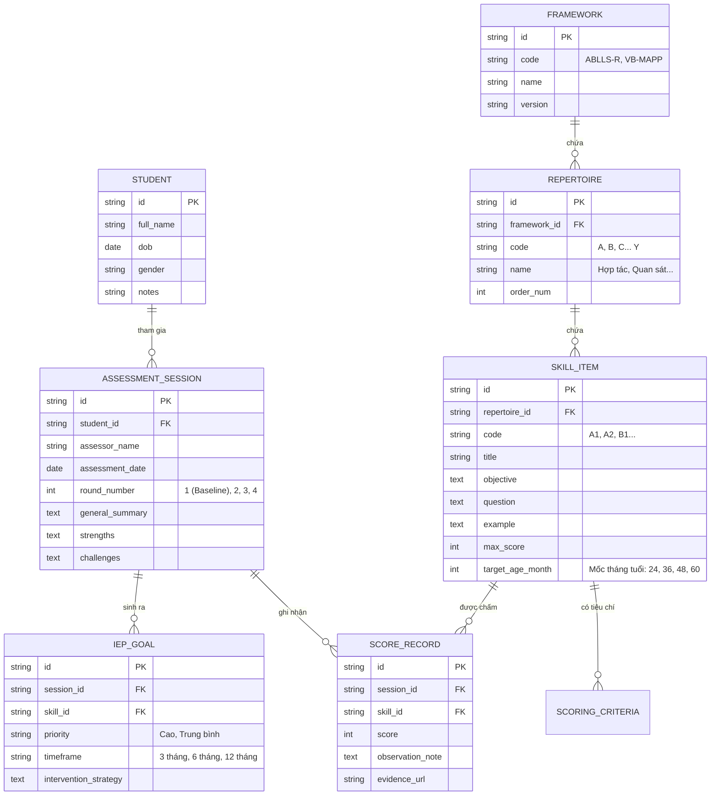
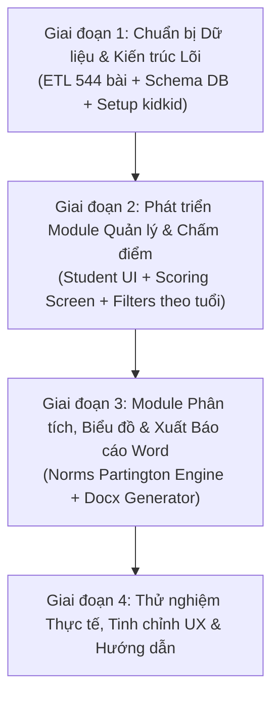

# BẢN PHÂN TÍCH CHUYÊN MÔN VÀ KẾ HOẠCH XÂY DỰNG WEB/APP QUAN SÁT & ĐÁNH GIÁ TRẺ ĐẶC BIỆT (DỰ ÁN KIDKID)

---

## PHẦN 1: PHÂN TÍCH HIỆN TRẠNG & ĐẶC THÙ NGHIỆP VỤ GIÁO DỤC ĐẶC BIỆT

### 1. Phân tích tài liệu hiện có trong thư mục `D:\ChiLinh`
Dựa trên khảo sát trực tiếp các tài liệu thực tế tại trung tâm:
1. **Bộ tài liệu đánh giá theo độ tuổi (`DanhGiaTheoTuoi`)**:
   - Gồm các file: `ABLLS_2Tuoi.xlsm`, `ABLLS_3Tuoi.xlsm`, `ABLLS_4Tuoi.xlsm`, `ABLLS_5Tuoi.xlsm`, và `ABLLS_Tonghop.xlsm`.
   - Mỗi file lọc ra danh sách các bài test phù hợp với từng mốc độ tuổi phát triển của trẻ.
2. **Bộ đánh giá tổng hợp (`DanhGiaTongHop`)**:
   - File lõi `ABLLS_DanhGia.xlsm` bao quát đầy đủ **25 nhóm lĩnh vực kỹ năng (Repertoires)** từ **A đến Y/Z** với **544 mục tiêu kỹ năng (Skill objectives)**:
     - *A. Hợp tác & Khen thưởng* | *B. Khả năng quan sát* | *C. Nhận biết (Receptive Language)* | *D. Bắt chước* | *E. Nói theo (Echoic)* | *F. Yêu cầu (Mands)* | *G. Gọi tên (Tacts)* | *H. Hội thoại liên tưởng (Intraverbals)* | *I. Ngôn ngữ tự phát* | *J. Cú pháp & Ngữ pháp* | *K. Vui chơi* | *L. Tương tác xã hội* | *M. Học nhóm* | *N. Tuân theo nề nếp lớp* | *P. Tổng hợp khái quát* | *Q. Đọc* | *R. Toán* | *S. Viết* | *T. Ghép vần* | *U. Tự mặc quần áo* | *V. Ăn uống* | *W. Tự chăm sóc* | *X. Đi vệ sinh* | *Y. Vận động thô* | *Z. Vận động tinh*.
     - Bảng **Mốc tuổi chuẩn (Norms theo James W. Partington, 2010)**: Tỷ lệ % trung bình đạt được của trẻ phát triển điển hình ở từng mốc mỗi 3 tháng (từ 6 tháng, 9 tháng, 12 tháng... đến 60 tháng tuổi).
3. **Báo cáo lượng giá thực tế (`BaoCaoDanhGia`)**:
   - Các file báo cáo chuẩn: `NGOC MINH_ABLLS REPORT.docx`, `Ro-ABLLS_REPORT-2026.docx`.
   - Cấu trúc chuẩn bao gồm:
     - Thông tin hành chính của trẻ & đợt đánh giá (Baseline, Đánh giá định kỳ 3 tháng, 6 tháng, 1 năm).
     - Giới thiệu công cụ ABLLS-R (Song ngữ Anh - Việt).
     - Bảng kết quả ngắn gọn (Tỷ lệ % từng lĩnh vực và đối chiếu so với mốc tuổi chuẩn).
     - Đánh giá tổng quan năng lực hiện tại (Điểm mạnh, hạn chế cần hỗ trợ).
     - Điểm nổi bật trong quá trình đánh giá (mức độ tương tác, hành vi cản trở, mức độ tập trung).
     - **Mục tiêu ưu tiên can thiệp (IEP - Individualized Education Program)** trong 3 – 6 – 12 tháng tới.

### 2. Các "nút thắt" lớn của giáo viên khi dùng Excel & Word thủ công
- **Thao tác chậm trên lớp:** Giáo viên khi đang tương tác 1-1 với trẻ phải mở file Excel lớn với hàng chục sheet, tìm kiếm mã bài rất mất tập trung và dễ làm gián đoạn buổi test.
- **Dễ sai sót công thức & dữ liệu:** Chấm điểm thủ công nhiều đợt, tính tổng điểm, tính tỷ lệ % trên Excel dễ bị đè nhầm công thức hoặc lệch mốc tuổi.
- **Mất nhiều giờ soạn báo cáo:** Để hoàn thành 1 báo cáo gửi phụ huynh/hồ sơ can thiệp, giáo viên phải copy điểm số từ Excel sang bảng Word, tự gõ lại từng mục tiêu IEP và viết nhận xét thủ công.
- **Khó theo dõi tiến trình liên tục:** Khó so sánh trực quan sự tiến bộ qua các lần can thiệp (Baseline -> Lần 1 -> Lần 2) nếu không duy trì biểu đồ lưới màu phức tạp.

---

## PHẦN 2: ĐỊNH HƯỚNG KIẾN TRÚC & GIẢI PHÁP ỨNG DỤNG "KIDKID"

### 1. Mô hình tổng thể (System Overview)
- **Loại hình:** Hệ thống Quản trị & Đánh giá nội bộ cho Trung tâm (Private/Internal Web App).
- **Thiết bị mục tiêu:**
  - **Màn hình Tablet/iPad & Mobile:** Tối ưu chế độ "Đánh giá nhanh tại lớp" (In-classroom Assessment Mode) với nút bấm to, giao diện thẻ câu hỏi trực quan, bộ lọc độ tuổi linh hoạt.
  - **Màn hình Laptop/Desktop:** Tối ưu cho Ban chuyên môn & Giáo viên trưởng phân tích số liệu, so sánh biểu đồ mạng nhện/lưới tiến độ và xuất báo cáo Word chuẩn.

### 2. Kiến trúc Công nghệ đề xuất (Tech Stack)
```
[Frontend Client]
├── Next.js 14 / React 18 + Tailwind CSS + Lucide Icons (Giao diện nhanh, hiện đại)
├── Chart.js / Recharts (Trực quan hóa biểu đồ radar, bar chart, ABLLS grid chart)
└── TanStack Query & Zustand (Quản lý trạng thái & cache dữ liệu đánh giá ngoại tuyến/trên lớp)

[Backend API & Xử lý báo cáo]
├── Node.js (Next.js API Routes) hoặc FastAPI (Python)
├── SQLite / PostgreSQL + Prisma ORM (Lưu trữ linh hoạt, dễ sao lưu và di chuyển)
├── Script ETL tự động (Đọc và import toàn bộ 544 bài từ D:\ChiLinh vào database)
└── docx-templates / python-docx (Tự động sinh báo cáo Word .docx chuẩn theo mẫu trung tâm)
```

### 3. Thiết kế Cơ sở dữ liệu mở (Flexible Assessment Schema)
Cơ sở dữ liệu được thiết kế theo cấu trúc module hóa cao, đảm bảo nạp hoàn hảo ABLLS-R và dễ dàng mở rộng sang các thang đo khác (VB-MAPP, ESDM, PEP-3):



---

## PHẦN 3: CÁC PHÂN HỆ CHỨC NĂNG CỐT LÕI (CORE MODULES)

### Phân hệ 1: Quản lý Hồ sơ Trẻ (Student Profile & History)
- Quản lý thông tin học sinh: Họ tên, Ngày sinh, Tuổi thực tế (tự động tính ra Tháng tuổi), Giáo viên phụ trách, Lịch sử can thiệp.
- Quản lý dòng thời gian đánh giá: Xem sự tiến bộ qua các mốc thời gian (Baseline -> Sau 3 tháng -> Sau 6 tháng -> Sau 1 năm).

### Phân hệ 2: Giao diện Chấm điểm Đánh giá Trực tiếp (Smart In-class Scoring)
- **Bộ lọc thông minh theo mốc tuổi:** Cho phép giáo viên lọc nhanh các bài test thuộc mốc 2 tuổi, 3 tuổi, 4 tuổi, 5 tuổi hoặc theo từng lĩnh vực kỹ năng (A-Y) để tránh quá tải.
- **Thẻ chấm điểm trực quan:** Hiển thị rõ câu hỏi, ví dụ minh họa và tiêu chí tương ứng với từng mức điểm (0, 1, 2, 3, 4).
- **Thao tác 1 chạm:** Chạm là lưu điểm ngay lập tức, tự động lưu nháp (Auto-save) phòng trường hợp mất mạng hoặc thoát trang đột ngột.
- **Ghi chú hành vi nhanh:** Trường nhập ghi chú quan sát ngay tại bài kiểm tra (ví dụ: *"Trẻ phản xạ sau 4 giây, cần gợi ý bằng mắt"*).

### Phân hệ 3: Bảng Phân tích & Trực quan hóa Dữ liệu (Analytics & Norms Engine)
- **Tự động đối chiếu Mốc tuổi chuẩn (Norms Comparison):**
  - Tự động lấy điểm số của trẻ đối chiếu với bảng Partington (2010) tương ứng với số tháng tuổi thực tế.
  - Phân loại rõ ràng:
    - *Kỹ năng đã thành thạo (Mastered)*
    - *Kỹ năng đang hình thành (Emerging)*
    - *Kỹ năng chưa xuất hiện (Not present)*
- **Biểu đồ trực quan:**
  - Biểu đồ mạng nhện (Radar Chart) thể hiện sự cân bằng giữa 25 lĩnh vực.
  - Biểu đồ tiến độ đa đợt (Progress Tracking Grid) mô phỏng chính xác lưới màu ABLLS-R chuẩn quốc tế.

### Phân hệ 4: Bộ máy Đề xuất Mục tiêu Can thiệp (IEP Engine) & Tự động Xuất Báo cáo
- **Gợi ý mục tiêu can thiệp cá nhân (IEP Suggestion):**
  - Tự động lọc ra các kỹ năng bị thiếu hụt ở các lĩnh vực nền tảng (như Giao tiếp, Yêu cầu, Bắt chước).
  - Đề xuất thứ tự ưu tiên mục tiêu can thiệp trong 3 tháng, 6 tháng và 12 tháng.
- **Xuất Báo cáo Word (.docx) 1 chạm:**
  - Xuất ra file Word giữ trọn vẹn format chuẩn của trung tâm (`Ro-ABLLS_REPORT-2026.docx` và `NGOC MINH_ABLLS REPORT.docx`).
  - Điền tự động toàn bộ bảng điểm, tỷ lệ %, phân tích tổng quan và các mục tiêu can thiệp đã chọn, giáo viên chỉ việc đọc soát và ký duyệt.

### Phân hệ 5: Module Import / Export Dữ liệu
- Tích hợp công cụ Import file Excel từ thư mục `D:\ChiLinh` để chuyển đổi toàn bộ hồ sơ học sinh cũ vào ứng dụng.
- Cho phép Export toàn bộ dữ liệu đánh giá ra định dạng Excel chuẩn để lưu trữ backup ngoại tuyến.

---

## PHẦN 4: KẾ HOẠCH TRIỂN KHAI CHI TIẾT (IMPLEMENTATION ROADMAP)

Dự án được phân kỳ thành **4 giai đoạn (Phases)** với mục tiêu rõ ràng và khả năng bàn giao sản phẩm chạy được (working prototype) qua từng mốc:



### Giai đoạn 1: Chuẩn bị Dữ liệu & Thiết lập Kiến trúc Dự án (Tuần 1)
- [x] Khảo sát toàn bộ cấu trúc file Excel và docx trong `D:\ChiLinh`.
- [ ] Khởi tạo dự án Web App tại thư mục `e:\Projects\kidkid` (Next.js 14, Tailwind CSS, TypeScript, SQLite/Prisma).
- [ ] Xây dựng Script ETL Python/Node.js để trích xuất 100% dữ liệu từ `ABLLS_DanhGia.xlsm` (544 bài tập, 25 lĩnh vực, tiêu chí chấm, bảng Norms) thành bộ dữ liệu JSON/Database chuẩn.
- [ ] Hoàn thành thiết kế Schema Database và API Service cơ bản.

### Giai đoạn 2: Giao diện Quản lý Học sinh & Chấm điểm Trên lớp (Tuần 2)
- [ ] Xây dựng màn hình Danh sách & Hồ sơ Trẻ (thông tin, ngày sinh, tính tháng tuổi).
- [ ] Xây dựng giao diện Chấm điểm Đánh giá tối ưu cho Tablet/iPad:
  - Thanh chọn lĩnh vực (A -> Y) và bộ lọc mốc tuổi phát triển (2, 3, 4, 5 tuổi).
  - Thẻ chấm điểm từng bài (Tên bài, Mục tiêu, Câu hỏi mẫu, Thang điểm 0 - max).
  - Tự động lưu tức thời (Auto-save) và ghi chú quan sát.

### Giai đoạn 3: Bộ máy Phân tích Số liệu, Biểu đồ & Xuất Báo cáo Word (Tuần 3)
- [ ] Xây dựng công thức tính toán % hoàn thành và đối chiếu với bảng Mốc tuổi chuẩn (Norms Partington 2010).
- [ ] Tích hợp biểu đồ trực quan (Radar chart, Progress bar).
- [ ] Xây dựng tính năng Gợi ý mục tiêu can thiệp (IEP Generator).
- [ ] Tích hợp Engine xuất file Word `.docx` tự động điền nội dung vào template chuẩn theo đúng cấu trúc của trung tâm.

### Giai đoạn 4: Kiểm thử, Tối ưu hóa Trải nghiệm & Triển khai Nội bộ (Tuần 4)
- [ ] Kiểm thử luồng đánh giá trọn vẹn với dữ liệu thực tế của học sinh mẫu.
- [ ] Kiểm tra tính chính xác của file Word xuất ra so với file gốc trong `BaoCaoDanhGia`.
- [ ] Hướng dẫn sử dụng cho giáo viên và bàn giao mã nguồn dự án.
